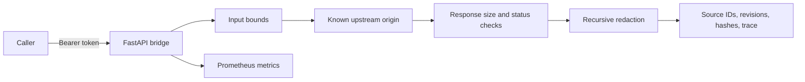

# Architecture

## Service boundaries

Liveness reports only that the process can answer. Readiness is protected and
checks both authentication configuration and upstream health. The schema route
publishes the intended read-only contract. The context route accepts no URL,
SQL, method, credential, or arbitrary operation from the caller.

The upstream adapter uses a configured base URL, disables redirects, applies a
short timeout, limits retries, rejects oversized responses, and normalizes only
the fields needed by the context contract.
